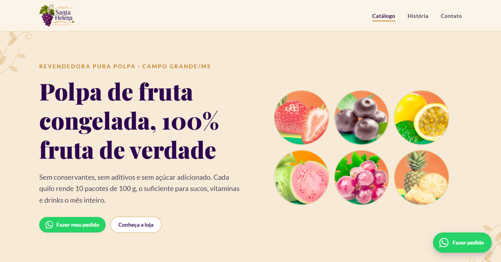

# Polpa Santa Helena

Catálogo online de uma distribuidora de polpas de fruta congeladas em Campo Grande/MS.
No ar em **[polpasantahelena.com.br](https://polpasantahelena.com.br)**.


<p align="center">
  
  
  
</p>

---

## O que é

Três páginas (catálogo, história e contato) que substituem o encaminhamento
de fotos de tabela de preço por WhatsApp. Não tem carrinho, login nem banco de
dados: cada produto leva direto para uma conversa no WhatsApp com a mensagem
já preenchida.

A escolha foi deliberada. O pedido já acontecia por WhatsApp e o volume não
justifica checkout; adicionar backend traria custo recorrente e manutenção sem
resolver nenhum problema real do negócio.

---

## Stack

| | |
|---|---|
| Front-end | React 19, TypeScript, React Router 7 |
| Estilo | Tailwind CSS 4 |
| Build | Vite 7 |
| Imagens | sharp (script offline), WebP |
| Qualidade | ESLint, TypeScript strict |
| Deploy | Vercel, com publicação a cada push na `main` |

---

## Como rodar

Requer Node.js 20 ou superior.

```bash
git clone https://github.com/Gabrielpossasb/Polpa_Santa_Helena.git
cd Polpa_Santa_Helena
npm install
npm run dev
```

Abre em `http://localhost:5173`.

| Comando | O que faz |
|---|---|
| `npm run dev` | Servidor de desenvolvimento |
| `npm run build` | Checagem de tipos + build de produção em `dist/` |
| `npm run preview` | Serve o build local |
| `npm run lint` | ESLint |

### Regerar as imagens do catálogo

Só é necessário ao trocar as fotos originais em `IMAGES/PRODUTOS/`:

```bash
npm i -D sharp
node scripts/prepare-images.mjs
```

---

## Estrutura

```
src/
├── components/     # agrupados por domínio: catalog, layout, ui, home, whatsapp
├── data/           # catálogo, configuração do site, textos e navegação
├── lib/            # utilitários puros (moeda, acentos, links de WhatsApp)
├── pages/          # uma por rota
└── types/          # tipos do domínio
scripts/            # pipeline de imagens (roda fora do build)
```

---

## Manutenção

Para alterar preços, adicionar sabores, marcar itens em falta ou trocar os
contatos, veja **[docs/MANUTENCAO.md](docs/MANUTENCAO.md)**.
